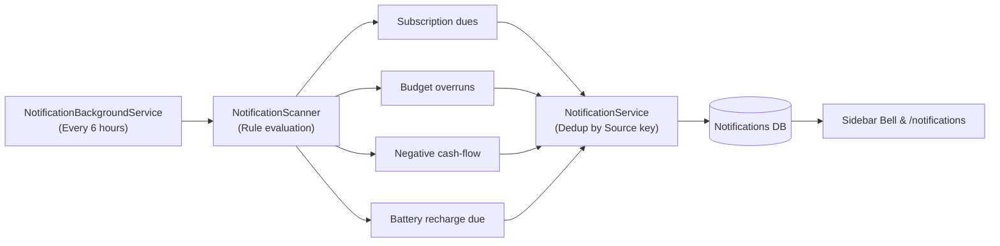

# 🔔 Notifications & Automated Scanner

LuminaVault features an automated background scanner and in-app notification center that proactively alerts you to upcoming bills, budget overruns, projected cash deficits, and battery maintenance tasks.

---

## 1. Scanner Architecture

The scanner consists of three coordinated components:

1. **`NotificationBackgroundService`**: A background worker that runs periodically (default every 6 hours) on an isolated scope.
2. **`NotificationScanner`**: Evaluates business rules across subscriptions, budgets, forecast models, and inventory assets.
3. **`NotificationService`**: Enforces deduplication and manages the notification lifecycle.



---

## 2. Rule Types

| Rule Type | Severity | Condition | Link Target |
|---|---|---|---|
| `SubscriptionDue` | `Info` | Active auto-renewing subscription due within lookahead days | `/subscriptions` |
| `BudgetOverrun` | `Warning` | Current month spend in a category exceeds the budget limit | `/budgets` |
| `ForecastNegative` | `Critical` | Forward cash projection dips below zero within lookahead window | `/forecast` |
| `BatteryChargeDue` | `Warning` / `Critical` | Lithium battery not charged within interval (Critical if >14d overdue) | `/items/{id}` |

---

## 3. Deduplication & Alert Lifecycle

Notifications use a deterministic, stable `Source` key with a unique database index:

- **Subscription alert**: `subscription:{id}:due:{YYYY-MM-DD}`
- **Budget overrun alert**: `budget:{category}:{YYYY-MM}:overrun`
- **Negative forecast alert**: `forecast:negative:{lowestDate}`
- **Battery recharge alert**: `item:{id}:battery-charge:{dueDate}`

### Key Invariants
- **No Duplicate Spam**: Re-running scans updates the existing record with latest numbers rather than inserting duplicates.
- **Resurfacing on Unresolved Conditions**: If a user marks an alert as `Dismissed`, but the underlying condition remains true on a subsequent scan cycle, the alert resurfaces as `Unread`.
- **Automatic Resolution**: Marking an item as charged immediately transitions related battery notifications to `Dismissed`.

---

## 4. UI & In-App Notification Center

- **Sidebar Unread Counter**: Live badge on the navigation bell updated automatically across route changes.
- **Notification Inbox (`/notifications`)**:
  - Filter pills for **Unread**, **All**, and **Dismissed**.
  - Direct navigation: Clicking an alert navigates directly to the relevant resource (asset, budget, subscription, or forecast view).
  - Bulk actions: **Mark all read** and **Rescan now** for instant manual scans without waiting for the background timer.

---

## 5. Configuration

Adjust scanner settings in `appsettings.json` or via environment variables:

```jsonc
// LuminaVault-Backend/appsettings.json
{
  "Notifications": {
    "Enabled": true,
    "IntervalHours": 6,
    "SubscriptionDueLookAheadDays": 3,
    "ForecastLookAheadDays": 30
  }
}
```
